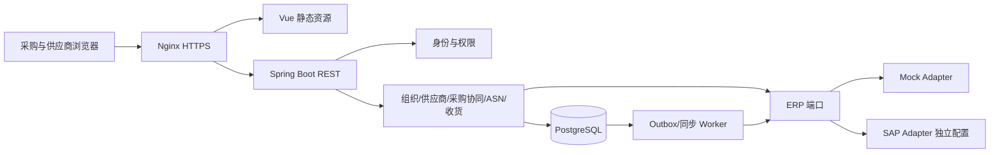

# 架构与决策

## 模块化单体

前端 Vue 3/TypeScript/Vite/Element Plus；后端 Java 21/Spring Boot 4.1.2，按业务包组织模块，REST/OpenAPI。版本调整见 ADR-007。
PostgreSQL + Flyway；首期使用数据库会话、幂等表、作业和 outbox，暂不引入 Redis 或消息中间件。
数据库是一套实例一套业务库，不用数据库 schema 冒充 SaaS 租户隔离。

| 模块 | 所有权 | 允许依赖 |
| --- | --- | --- |
| identity | 用户、角色、会话、授权 | foundation、organization 查询端口 |
| organization | 集团、公司、工厂、采购组织 | foundation |
| supplier | 供应商、公司关联、供应商用户绑定 | foundation、organization |
| purchasing | 订单版本、行、计划行、确认、延期审批、交货计划 | organization/supplier 公共查询端口、ERP 端口 |
| shipping | ASN、发货分配、预留 | purchasing 公共命令/查询端口 |
| receiving | ERP 收货/冲销、收货分配、对账 | purchasing/shipping 公共端口 |
| integration | ERP 端口、同步作业、外部标识、游标、重试 | foundation；通过命令端口导入业务模块 |
| adapters.mock / adapters.sap | 实现 ERP 端口 | integration API；不得反向引入核心 |
| notification / audit | 通知、审计事件读模型 | foundation；事件订阅，不反向控制业务 |
| foundation | 错误、ID、时间、事件信封 | 不引用业务模块；禁止堆放业务规则 |

实际目录：`backend/`、`frontend/`、`deploy/`、`scripts/`、`docs/`、`tests/`。Phase 01 已建立工程，Phase 02 在 organization、supplier、access 包实现组织与供应商主数据，复用 identity 命令事务入口。
包前缀采用 `org.opensrm`，这是命名选择，不声明拥有对应域名。

## 事务、并发与集成

请求链：认证 → 操作授权 → 解析对象及范围 → 校验版本/状态/数量 → 幂等占位 → 本地业务+审计+outbox 提交 → 返回结果。
所有读写及幂等重放都重新校验当前权限。数量相关操作按固定顺序锁计划行，再做计算；`If-Match` 防止丢失更新。多进程并发由数据库唯一键/锁保障，不能仅用内存锁。
幂等键按 deployment/actor/operation/key 唯一，记录规范化请求摘要及原始响应；不同请求内容返回 409；事务回滚不得留下已完成记录。详情见 API 文档。

ERP 调用不在数据库业务事务中进行；outbox 至少一次投递，外部系统必须支持业务幂等键或查询对账；不得声称跨系统恰好一次。
超时未知结果标记 UNKNOWN 待查询，不盲目重复发布。同步采用 inbox 唯一事件 ID + 事务游标提交；失败页不推进游标。版本乱序进入隔离队列，原始负载只可脱敏存储在私有区域并限制留存。

## 部署与安全边界

规划 Compose 由 Nginx、后端、数据库构成，数据库不对外映射；应用非 root，健康检查区分存活和就绪，迁移失败不就绪。会话不存浏览器 localStorage；禁用用户时撤销会话。
首期本地登录，接口将来可接 OIDC；不额外实现未需求的身份服务。组织名称、时区、品牌、ERP 映射为实例配置/数据库数据，不编入前端。
每实例 `deployment_id` 为隔离及将来迁移预留；真正 SaaS 需重新设计认证、唯一约束、缓存和任务隔离，不能只添加一个 tenant 字段宣称完成。

## 关键 ADR

- ADR-001：采用模块化单体，降低跨服务事务与部署复杂度；通过端口和模块测试保留演进空间。
- ADR-002：ERP 是订单及收货权威；SRM 协同记录独立，SAP 字段在适配器映射。
- ADR-003：生命周期、协同确认、延期审批、发货和收货独立；列表状态为派生视图，禁止混用“已送货/已收货”。
- ADR-004：不选定开源许可证，不创建远端或生产连接；发布前单独审查。
- ADR-005：Phase 00 规格用 Python 标准库便于离线核对，生产后端仍使用 Java；不发展第二套 Python 后端。
- ADR-006：Spring Boot 保持用户要求的 3.5.x；Phase 01 核实补丁与支持窗口后固定具体版本，不引用浮动 latest。

以上 3.5.x 是 Phase 00 初始选型；Phase 01 的 ADR-007 替代该版本决策，保留 Java 21 与业务边界。

- ADR-007：Phase 01 首次安全审计发现 Spring Framework 6.2.19 的已知漏洞，而公开 6.2.x 未提供对应修复。采用 Spring Boot 4.1.2 / Spring 7.0.x，使用新版 Web MVC/Flyway/JDBC Session starter 与 Jackson 3，重新执行全部后端及页面验收，不抑制已知告警。依据：[漏洞公告](https://github.com/advisories/GHSA-j9f9-w8pj-32f8)、[官方系统要求](https://docs.spring.io/spring-boot/system-requirements.html)、[迁移指南](https://github.com/spring-projects/spring-boot/wiki/Spring-Boot-4.0-Migration-Guide)。
- ADR-008：身份写入暂以实例行锁序列化，保证最后管理员规则、并发幂等和审计原子性。事务量较小时先采用简单可靠方案；后续采购并发按业务聚合分别锁定，不能复用全实例锁。
- ADR-009：含密码的用户创建请求使用私有 HMAC 密钥生成幂等摘要，数据库不保存密码的快速裸哈希。账号密码只保存 BCrypt，JDBC 会话只存身份及撤销版本。

已落地的数据库子集为身份、角色、会话、审计、幂等、登录保护，以及 Phase 02 的组织、供应商关系和范围授权。Phase 03 已落地采购订单、版本与同步；确认/ASN/收货仍是后续设计。应用部署/测试边界见 `installation.md` 与阶段验收记录。

- ADR-008：Phase 02 角色与范围分离。ADMIN 管理部署目录但不隐含供应商业务范围；SUPPLIER 独立角色与单供应商绑定，范围在 SQL 中过滤后分页。共享主档修改要求全部关联公司权限；范围/关系撤销即时生效。详见 [实现设计](phase-02-design.md)。
- ADR-009：当前所有写入沿用单实例 app_guard 行锁，业务、审计和幂等结果原子提交。此串行化方案适合第一期测试规模，吞吐与多节点扩展需 Phase 08 压测后再决定，不宣称已具备高并发能力。

- ADR-010：Phase 03 订单采用不可变版本下的行与计划行，当前订单仅移动版本指针。来源标签不透明，适配器另提供可比较序列；规范化数量/行顺序后计算摘要，未知旧序列与同版本异内容分别隔离，不解析 SAP 特定版本格式。
- ADR-011：核心仅依赖 integration.port；adapters.mock 实现七端口。同步任务/游标/收件去重/版本导入/隔离/审计同事务，一页一个事务，进程中断回滚未提交页。现有后台为单执行器、Mock 本地读取；真实网络 IO、退避和吞吐扩展在 Phase 06/08 单独验收。

- ADR-012：Phase 04 使用已有命令事务入口实现确认/数量预占/审批/派生计划，保持角色动作与同元组数据范围分离。ERP 导入调用 collaboration 生命周期端口，在同一事务中使旧协同失效；内部 outbox 不调用 ERP 或消息服务。确认/申请/计划分别有自己的状态，不能由订单生命周期直接推断实际收货。

## ADR 013：发货预留与权威收货独立记账

ASN 草稿及提交使用独立聚合，ERP 事件由 GoodsReceiptProvider 经持久同步任务导入。收件箱保留来源载荷及摘要，事件与冲销追加写，分配账本关联具体 ASN 行。逻辑订单行键跨来源版本聚合收货/在途；订单改版不会清空预算。复用实例事务锁保证多行数量、审计、事件及幂等结果原子提交，后续规模扩大后再评估分桶行锁。

- ADR-013：Phase 07 使用 PostgreSQL 内部投递表和通知表，不增加消息中间件。复用业务 outbox，投递状态独立；业务事件与同步失败持久化后由有限批次工作者分发。来源版本检查、当前接收者权限、消息唯一键与事务共同保证可重放去重；通知是历史提示，业务操作必须回到原接口重新校验。统计在 SQL 权限过滤后聚合，每个数量账本分别汇总以避免关联倍增。

- ADR-014：Phase 08 不增加业务表/中间件，补充发布回归与恢复维护工具。写请求 Origin 同时核对配置中的协议、Host 和端口，不信任客户端转发头；CSRF 和全部原业务权限/事务约束继续生效。恢复在独立项目/新卷内核对全部表摘要，API 仅内部网络并禁用 ERP 写入/真实适配，详细边界见 [设计](phase-08-design.md)。
