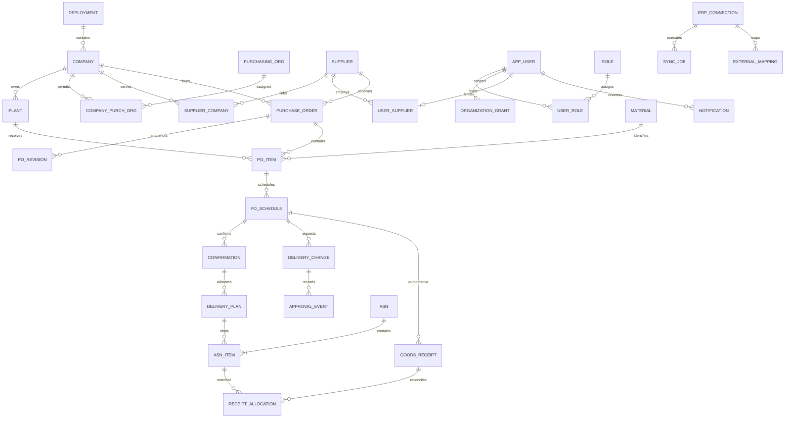

# 数据模型与 ERD

本页是完整业务逻辑设计。Phase 01 身份与 JDBC 会话已形成 V1/V2 迁移；Phase 02 新增 `V3__organizations_suppliers_and_scopes.sql`，落地 company、plant、purchasing_org、company_purch_org、supplier、supplier_company、organization_grant、user_supplier 和 audit_event_company。V1/V2 保持原样，不重建已有数据。Phase 03 的订单及同步表已落地；确认/ASN/收货表仍属后续阶段。使用 PostgreSQL UUID 主键、UTC `timestamptz`；后续业务 `date`、数量 `numeric(19,6)` 和金额 `numeric(19,4)`；API 数量为字符串以避免浮点误差。
数量接口限制整数部分最多 13 位，小数最多 6 位。跨币种/单位不相加，首期不支持单位转换。

## 表与关键约束

Phase 03 追加 V4：erp_connection、erp_plant_mapping、material、purchase_order、po_revision、po_item、po_schedule、sync_job、sync_cursor、inbox_event、sync_issue。订单当前指针引用属于本订单的版本；行/计划随版本不可变保存，历史不覆盖。连接、公司、采购组织、供应商和工厂均带关系约束；来源版本标签与可排序序列分别保存。计划行未增加伪造的确认/收货量。
同步以 connection 隔离来源命名空间，connection 绑定 source_system/client；收件键为连接/订单外部键/来源版本，内容摘要另行对比；隔离记录按任务保留安全错误码。当前 V4 之外的协同表仍为规划。

| 表 | 关键字段和约束 |
| --- | --- |
| deployment | id、display_name、timezone；首期一个实例一个有效 deployment |
| company / plant | deployment_id、code、name；工厂带 company_id；组织内 code 唯一 |
| purchasing_org / company_purch_org | 跨公司采购组织；关联键唯一；全部带 deployment_id |
| supplier / supplier_company | 通用编码、状态、公司关系；(supplier,company) 唯一；无真实演示税号 |
| material | ERP 来源映射、基本单位、有效状态；(deployment,code) 唯一 |
| app_user / role / permission / role_permission / user_role | 账号哈希、状态、会话版本、角色和动作授权；不得存明文口令 |
| organization_grant / user_supplier | subject、permission、company、plant?、purchasing_org?；供应商用户唯一绑定 |
| user_session | 用户、会话摘要、expires_at、revoked_at、CSRF 摘要；不保存原始会话密钥 |
| purchase_order | deployment、connection、external_id、company、purch_org、supplier、source_revision、lock_version、lifecycle、consistency_hold；(connection,external_id) 唯一 |
| po_revision | order、source_revision、hash、received_at、脱敏结构化快照；(order,source_revision) 唯一；不可覆盖 |
| po_item | order、external_item、plant、material、unit、currency、price、status；(order,external_item) 唯一 |
| po_schedule | item、external_schedule、ordered_qty、requested_date、lock_version；(item,external_schedule) 唯一 |
| confirmation | schedule、source_revision、qty、promised_date、status、actor、created_at；不删除历史 |
| delivery_change | schedule、confirmation、source_revision、proposed_date、reason、status、requester、lock_version |
| approval_event | change、actor、decision、reason、created_at；记录不可变；终态审批唯一 |
| delivery_plan | confirmation、schedule、qty、due_date、status、version；只从当前有效确认生成；计划量总和不超过有效确认量 |
| asn / asn_item | 头绑定 supplier/company；行绑定 plan/schedule、qty、source_revision；不允许跨公司/供应商混单；头行有版本 |
| goods_receipt | connection、external_doc、fiscal_year、external_item、schedule、qty、event_type、reversal_of、posting_date；来源事件复合键唯一 |
| receipt_allocation | receipt、asn_item、qty；同一收货分配合计不超事件数量；冲销按原分配释放；无 ASN 收货保持未分配 |
| erp_connection / external_mapping | adapter_type、capabilities、config_ref；只存秘密引用；外部键包含 source_system、client、entity_type、external_key |
| sync_job / sync_cursor / inbox_event | 作业、脱敏错误、每流游标、事件摘要；inbox 来源事件唯一；游标与导入同事务 |
| outbox_event | event_id、aggregate、revision、payload、status、attempts、next_attempt_at；幂等发布 |
| idempotency_record | deployment、actor、operation、key、request_hash、response、expires_at；组合唯一；响应过滤秘密 |
| audit_event | deployment、actor、scope、operation、object、before/after 摘要、request_id、timestamp；追加写、读单独授权 |
| notification | recipient、scope、event_id、read_at；(recipient,event_id,channel) 唯一；不能透出越权对象 |

## 引用、数量与并发

所有业务表带 deployment_id，跨表使用复合外键 `(deployment_id,id)` 防止串实例；同理工厂/公司与供应商公司关系通过复合键/服务事务校验。
ASN 行引用的计划、确认、订单版本、供应商、公司必须一致。ERP 收货可无 ASN 关联，不能为满足外键伪造 ASN。
取消、缩量、版本变更不删除行，写新版本并执行一致性检查。来源版本不可排序时适配器提供可比较序列与内容摘要，不把 SAP ETag 当整数。
CHECK 保证数量正数、非空状态和合法枚举；跨行合计用事务行锁与服务不变量保障，不用单行 CHECK 假装覆盖并发。
收货冲销事件为正量加 `event_type=REVERSAL` 和原事件引用；同一原事件累计冲销不得超过原收货。原事件未到达时隔离等待，不直接丢弃或扣负数。

索引：订单 `(company_id,supplier_id,lifecycle,id)`、行 `(plant_id,order_id)`、计划 `(schedule_id,status,due_date)`、ASN `(supplier_id,status,created_at)`、收货 `(schedule_id,posting_date)`、任务 `(status,next_attempt_at)`、审计 `(scope,created_at,id)`、授权 `(subject,permission,company_id)`。
具体查询计划在 Phase 03/08 基于真实规模的虚构数据 `EXPLAIN` 验证。API 列表采用稳定排序，分页上限 100。

迁移原则：Flyway 已发布迁移只追加不改写；破坏性变更先兼容扩展、迁移数据、验证后收缩；变更前备份，在恢复副本验证。Phase 00 不包含生产 DDL 或真实数据库访问。

## Phase 04 事务模型

V5 落地 confirmation、delivery_change、approval_event、delivery_plan、outbox_event。数量 numeric(19,6)，待批/生效确认同计划行累计不能超订购量；跨行约束由实例事务锁和服务守卫保证。每确认至多一个待批申请、每申请一个不可变决策、每确认版本一个计划由唯一索引约束。来源快照和计划行外键保留，失效只改业务状态/版本。
outbox 只保存必要的订单/聚合/版本及事件类型引用，PENDING/SUPERSEDED 内部账本尚无分发器。后续分发须校验当前来源与聚合版本，不能直接发送已过期事件。通知和 ERP 发布不在 Phase 04 启用。

## Phase 05 事务模型

V6 增加 asn/asn_line、receipt_inbox、receipt_event、receipt_allocation；sync_job 增加 entity_type（已有行默认为 PURCHASE_ORDER）。原迁移不改写。ASN 多行引用 immutable 计划和来源 schedule；跨版本预算通过订单与外部行/计划行键聚合。计划状态扩展部分/全部送货，数量与版本变更仍在同一 app_guard 锁事务。

receipt_inbox 保留来源有效或异常载荷与内容摘要；receipt_event 仅接受匹配的权威事件，连接/来源凭证复合键唯一；冲销为正数量加 REVERSAL 和 original_id，绝不覆盖原事件。receipt_allocation 记录来源明确的逐 ASN 行分配，冲销分配不能超原分配净余额。超收事件仍入账，另记录异常并冻结订单。收货/冲销状态由事件计算，不向原来源事件写状态。

## Phase 06 事务模型

V7 扩展 erp_connection.adapter_type（Mock/SAP OData）、sync_job.entity_type（包含 METADATA），分页游标长度扩为 4000；新增 next_attempt_at 供有限退避。保留原实例、连接、订单、收货与会话数据。SAP 实际接口的来源版本策略和计划行映射限制见 [Phase 06](phase-06-design.md)。

## Phase 07 实现

V8 追加 notification_delivery（来源类型/标识/版本唯一、业务引用、投递状态、次数、退避及锁版本）与 notification（投递/接收人/渠道唯一、已读时间及锁版本）。不更新旧 outbox 行来保存投递状态；旧事件仍由业务生命周期维护。消息不复制业务原文或敏感响应。通知、成功投递状态同事务；失败回滚后独立记录安全错误码。已读/人工重试沿用幂等与审计事务，并关联对应公司和供应商。具体口径见 [Phase 07 设计](phase-07-design.md)。
